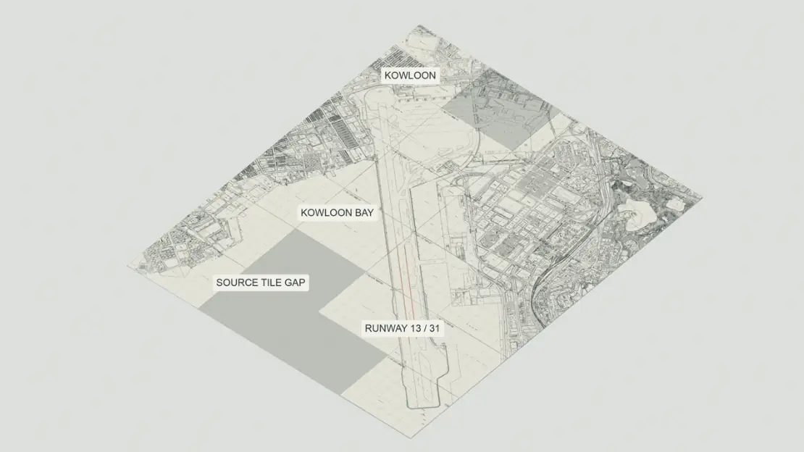
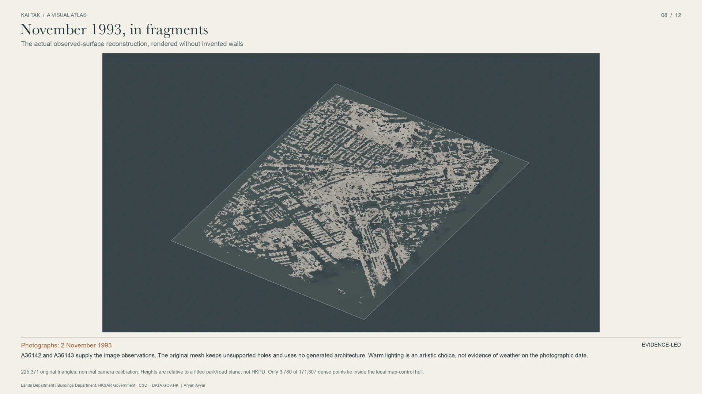
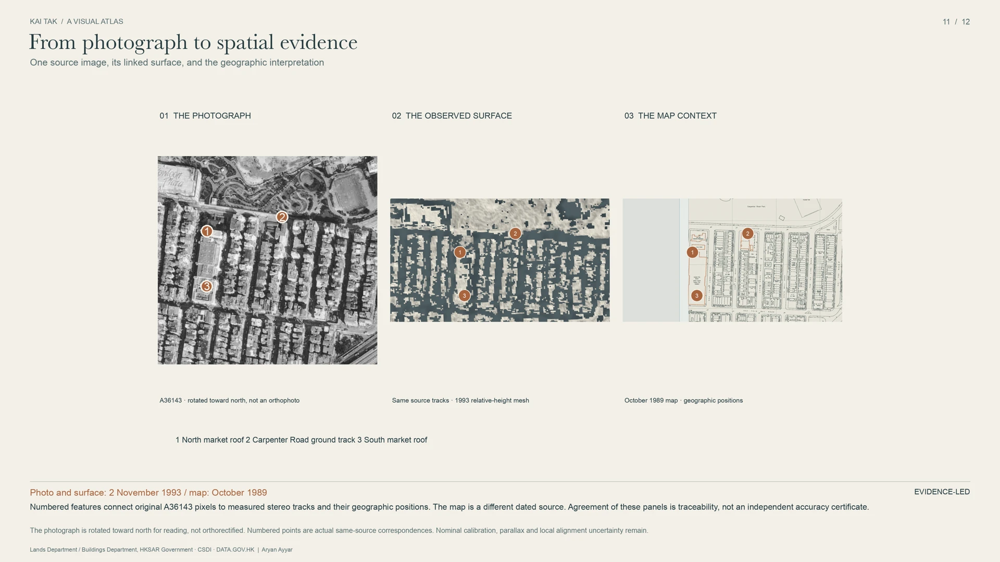
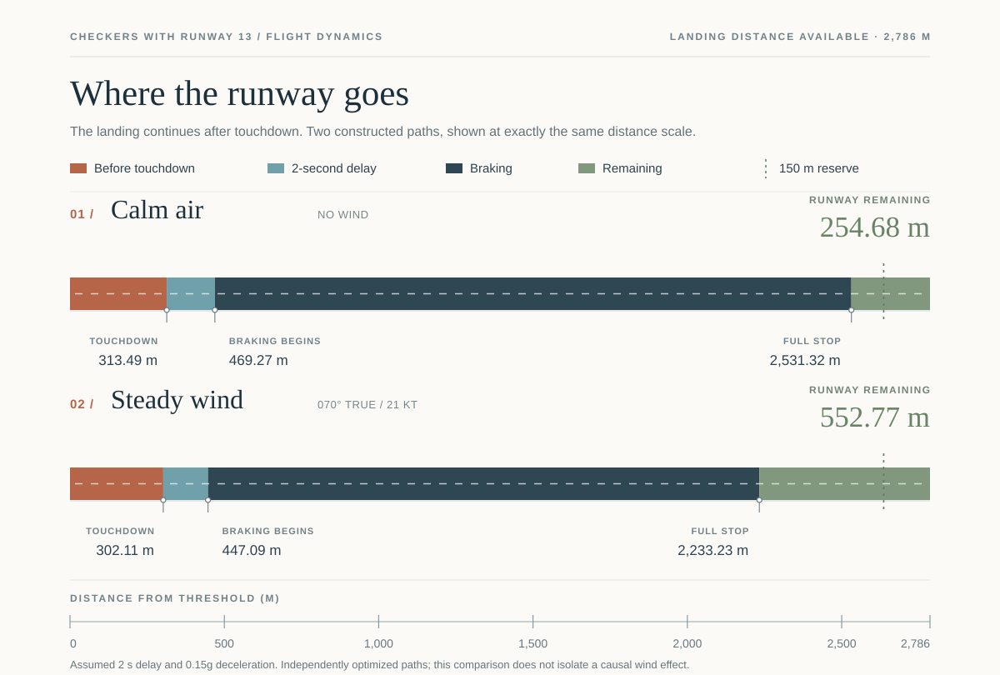

# Checkers with Runway 13

**A 47° turn over Kowloon. A runway that still had to be long enough to stop.**

Historical geography · 3D reconstruction · Flight dynamics · Mathematical verification

[**Read the white paper**](research/checkers-runway13/whitepaper/v5/checkers-with-runway-13-white-paper-v5.pdf) · [**Explore the visual atlas**](visual-atlas/v1/README.md) · [**Latest mathematical results**](publication/scientific-results-20261013/README.md) · [**Browse the archive**](archive/README.md)

  

From the <a href="visual-atlas/v1/README.md">Kai Tak Visual Atlas</a>. Historical sources, model geometry and illustrative context are identified separately in the atlas.

---

## The problem

For aircraft approaching Hong Kong's former Kai Tak Airport, the instrument guidance direction and Runway 13 were separated by **47 degrees**. Pilots followed the offset instrument guidance and then made a visual right turn over Kowloon to line up with the runway. Landing required more than completing that turn: the aircraft also had to descend, touch down and stop.

**How do you fit the turn, the descent and the full stop into one constrained trajectory?**

This repository approaches the question from several directions: official aviation records, dated survey maps, aerial photographs, 3D photogrammetry, flight dynamics, optimization and computer-assisted proof. The [38-page illustrated white paper](research/checkers-runway13/whitepaper/v5/checkers-with-runway-13-white-paper-v5.pdf) tells the story; the underlying models, source evidence and reproducible calculations live here.

## Start exploring

| | Start here | What you will find |
| :--- | :--- | :--- |
| **Read** | [White paper · V5](research/checkers-runway13/whitepaper/v5/checkers-with-runway-13-white-paper-v5.pdf) | From bank angle and turning radius to wind, touchdown, runway consumption and the CAL605 record. |
| **See** | [Visual atlas · V1](visual-atlas/v1/README.md) | Twelve 4K plates, source-linked Blender scenes and an illustrated view of the airport and the surviving 1993 surface evidence. |
| **Study** | [Mathematical results](publication/scientific-results-20261013/README.md) | Certified landing constructions, analytical bounds and the newer local-optimality theorem. |
| **Explore evidence** | [Historical research archive](archive/README.md) | Versioned maps, photographs, weather evidence, catalogues and source-specific provenance. |
| **Reproduce** | [Verification and build instructions](#reproduce-the-research) | Public scientific tests, archive restoration and the V5 manuscript build. |

## From photographs to 3D evidence

<table>
<tr>
<td width="50%"></td>
<td width="50%"></td>
</tr>
<tr>
<td><strong>November 1993, in fragments</strong> Observed surfaces reconstructed from overlapping historical aerial frames.</td>
<td><strong>From photograph to spatial evidence</strong> The photographs, map controls and reconstructed geometry behind the image.</td>
</tr>
</table>

The historical reconstruction currently contains **171,307 filtered dense stereo points** and an open surface mesh of **225,371 triangles**. Its holes remain visible; the geometry is not a complete model of every building in 1993. The stereo heights are relative to a fitted local plane, and only **3,780 points** lie inside the map-control hull.

The broader evidence collection includes **227 survey-map archives across 93 sheet locations** and **48 full aerial frames**. See the [reconstruction report](research/checkers-runway13/reconstruction/block_matching/REPORT.md), [3D workbench](research/checkers-runway13/reconstruction/block_matching/scene/README.md) and [visual atlas provenance](visual-atlas/v1/metadata/SOURCE_AUDIT.md).

[**View all twelve atlas plates →**](visual-atlas/v1/README.md) · [Print atlas (PDF)](visual-atlas/v1/renders/print/Kai-Tak-Visual-Atlas-A4.pdf)

## From flight dynamics to a complete stop

The famous turn is a useful entry point into the mathematics. In an ideal coordinated, level turn, a **15° bank** at **78 m/s** yields a radius of approximately **2.32 km**. Sustaining the turn for about **24.35 seconds** accumulates **47°** of heading change. Bank angle and the total change in direction are different quantities.

The landing problem continues after alignment. Under the white paper's illustrative constant-deceleration ground law,

\[
\text{stopping station}=x_D+u d+\frac{u^2}{2a},
\]

where \(x_D\) is touchdown position, \(u\) is touchdown ground speed, \(d\) is braking delay and \(a\) is deceleration.

The V5 paper constructs and continuously verifies **two separate synthetic landings**:

| White-paper scenario | Touchdown beyond threshold | Full stop | Runway remaining |
| --- | ---: | ---: | ---: |
| Calm air | 313.49 m | 2,531.32 m | **254.68 m** |
| Steady wind (070° true, 21 kt) | 302.11 m | 2,233.23 m | **552.77 m** |

Both use a 2,786 m landing-distance allowance and the paper's declared reduced model and stopping law. They are **separately optimized examples**, not a controlled estimate of the effect of wind.

### Latest result: certified local optimality

Newer calculations go beyond the two V5 examples. Under the later, explicitly assumed **A1 geometry and aircraft model**, the project establishes:

- A **strict local primary optimum in five flare variables**, based on a validated nine-equation root and positive active-constraint multipliers.
- A connected **non-strict local primary optimum** within the defined **12-parameter trajectory family**, with whole-time feasibility checks.
- A certified local primary value near **η = 0.1523607643**, and a still-open global-family bracket of **[0.15236076430186170190, 0.181970215]**.
- A certified primary-objective loss no greater than **10⁻⁴** for the delivered secondary path relative to that proved *local* primary optimum.

The root's exact mathematical object is its interval certificate, not its rounded printed value. The later A1 model is distinct from V5's earlier synthetic geometry; the figures and numerical values above should not be interpreted as the same trajectory.

[**Read the theorem and certificate →**](research/checkers-runway13/integrated/assumption_solution/refinement/local_certificate/REPORT.md) · [Derivation](research/checkers-runway13/integrated/assumption_solution/refinement/local_certificate/DERIVATION.md) · [Conditional results and open cases](research/checkers-runway13/integrated/assumption_solution/refinement/REPORT.md)

## Get the data

The [Kai Tak Historical Research Archive](archive/README.md) catalogues **3,268 artifacts across 44 datasets and nine collections**. Its [v1.0.0 release](https://github.com/ayyararyan/kai-tak/releases/tag/archive-v1.0.0) distributes **418 source-permitted files** in five verified bundles (approximately 825 MB compressed in total).

Clone the repository and inspect the available collections:

~~~bash
git clone https://github.com/ayyararyan/kai-tak.git
cd kai-tak
python3 scripts/fetch_data.py --list
~~~

Restore just the weather collection, or omit `--collection 05` to restore all permitted bundles:

~~~bash
python3 scripts/fetch_data.py --release v1.0.0 --collection 05
~~~

The archive tools support Python 3.12+ on POSIX systems. Bundles are hash-verified, and collection catalogues also record material that cannot be distributed in the release.

[Archive catalogue](archive/CATALOGUE.md) · [Download guide](archive/DOWNLOAD.md) · [Source rights](DATA_SOURCES.md)

## Reproduce the research

**Verify the latest public mathematical results** using the preserved scientific snapshot:

~~~bash
python3.12 -m venv .venv-scientific
.venv-scientific/bin/python -m pip install -r publication/scientific-results-20261013/requirements.txt
.venv-scientific/bin/python publication/scientific-results-20261013/run_public_tests.py
~~~

These commands check the publicly reproducible numerical and proof components. Some historical-source and original-workspace integrity tests require materials that are not publicly redistributed; their status is documented in the [scientific snapshot](publication/scientific-results-20261013/README.md).

**Rebuild white paper V5** with its separate, pinned scientific and typesetting environment:

~~~bash
cd research/checkers-runway13/whitepaper/v5
python3 -m venv .venv
.venv/bin/python -m pip install -r requirements.txt
.venv/bin/python build.py --figures
.venv/bin/python verify_certificates.py
~~~

V5 additionally requires XeLaTeX, BibTeX, Poppler and locally licensed fonts. Its [build guide](research/checkers-runway13/whitepaper/v5/README.md), [reproducibility record](research/checkers-runway13/whitepaper/v5/REPRODUCIBILITY.md) and [claim-level verification](research/checkers-runway13/whitepaper/v5/SCIENTIFIC_VERIFICATION.md) document the tested toolchain and checks.

## Repository map

| Location | Contents |
| --- | --- |
| [`research/checkers-runway13/`](research/checkers-runway13/README.md) | Flight model, historical reconstruction, analytical work, CAL605 evidence and integrations. |
| [`visual-atlas/v1/`](visual-atlas/v1/README.md) | Exhibition plates, editable 3D scenes, source records and rendering code. |
| [`archive/`](archive/README.md) | Historical data catalogue, releases, licensing and integrity records. |
| [`publication/`](publication/scientific-results-20261013/README.md) | Published research snapshots, manifests and public verification. |
| [`scripts/`](scripts/fetch_data.py) | Data acquisition/restoration and repository utilities. |

The central unresolved historical task is to register dated urban geometry, runway coordinates and obstacle heights in a defensible common reference, then connect them to a calibrated aircraft model. The [historical integration report](research/checkers-runway13/integrated/REPORT.md) documents the remaining runway-reference and vertical-datum issues. The mathematical results are rigorous within their stated assumptions; they are not certification of a historical flight or operational guidance.

## Citation, rights and credits

For the paper, cite **Ayyar, A. (2026), _Checkers with Runway 13_, white paper V5** and link the [versioned PDF](research/checkers-runway13/whitepaper/v5/checkers-with-runway-13-white-paper-v5.pdf). For data, cite the precise archive version and relevant collection using [`CITATION.cff`](CITATION.cff). No DOI has been registered.

Original research and code © 2026 Aryan Ayyar. The repository is public, but **no blanket open-source licence has been granted**. Historical maps, imagery and other third-party sources retain their own rights. Consult [NOTICE](NOTICE.md), [data-source terms](DATA_SOURCES.md) and [figure provenance](research/checkers-runway13/whitepaper/v5/RIGHTS_AND_PROVENANCE.md) before reuse.

This independent research project used AI assistance for implementation, drafting, figures and checks; it does not claim independent specialist peer review.
