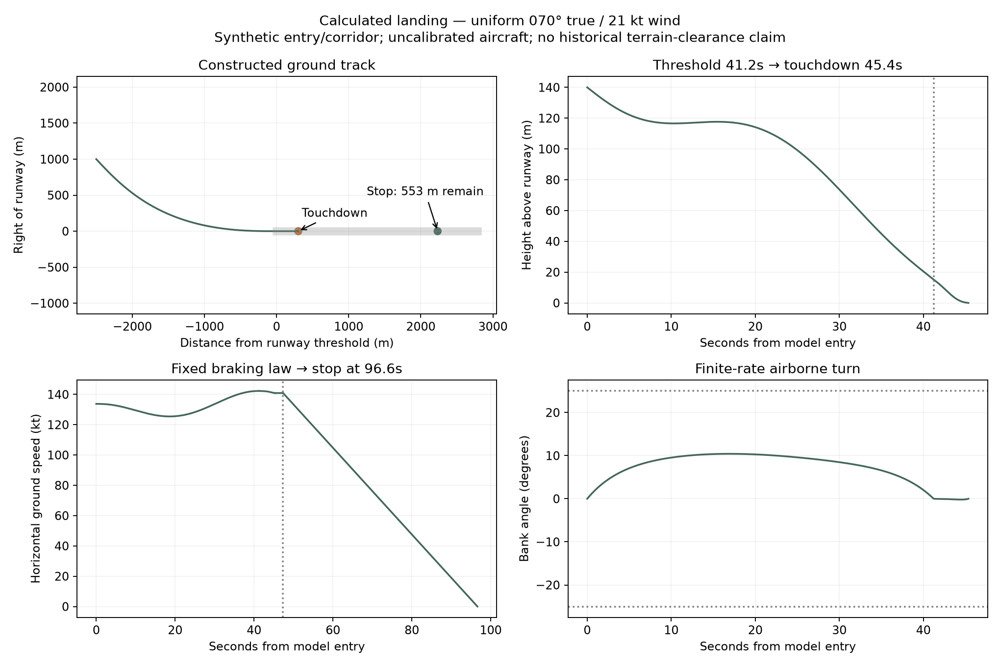

# Checkers with Runway 13


Historical reconstruction and mathematical study of the Kai Tak Runway 13 approach: dated Kowloon geometry, flight/weather evidence, constrained landing trajectories, and explicit approximations with verifiable bounds.

**Work in progress.** This repository is a snapshot of research assembled on 13 October 2026. It is not an operational flight procedure, a validated aircraft simulator, or a claim that the historical approach was globally optimal or suboptimal.

## White paper · version 3

**[Read Checkers with Runway 13 — 33-page PDF](research/checkers-runway13/whitepaper/v3/checkers-with-runway-13-white-paper-v3.pdf)** · [Editable source ZIP](research/checkers-runway13/whitepaper/v3/checkers-with-runway-13-white-paper-v3-sources.zip) · [Build instructions](research/checkers-runway13/whitepaper/v3/README.md) · [Verification report](research/checkers-runway13/whitepaper/v3/VERIFICATION.md)

Version 3 develops the investigation through eight narrative parts, 16 scientific figures and seven worked insights, with mathematical appendices and a 51-claim evidence ledger. It connects dated imagery and maps, turn mechanics, complete calm/wind landings, the CAL605 record and the limits of historical reconstruction. The exact title, frozen models, separate certificates and corrected bounds are preserved. All 33 pages were visually inspected; 89 model/counterfactual tests passed and a clean rebuild matched the page text and rendered pixels. The first-person foreword remains explicitly marked for author review.

The manuscript does not establish historical obstacle clearance, calibrated aircraft performance, near-optimality or operational safety. [Publication record](research/checkers-runway13/whitepaper/v3/PUBLICATION.md). Version 2 remains available below.

## White paper · version 2

**[Read the 30-page PDF](research/checkers-runway13/whitepaper/v2/checkers-with-runway-13-white-paper-v2.pdf)** · [Editable source ZIP](research/checkers-runway13/whitepaper/checkers-with-runway-13-white-paper-v2-source.zip) · [Build instructions and evidence](research/checkers-runway13/whitepaper/v2/README.md)

Version 2 adds a complete landing under the declared steady 070° true / 21 kt mean-wind scenario: touchdown at **302.11 m**, stop at **2,233.23 m**, and **552.77 m** of runway remaining with unchanged 2-second / 0.15g braking. Its own interval certificate establishes normalized margin **≥0.1507934696816132**; a separate necessary upper bound is **0.2167443782**. This remains a synthetic-entry/corridor research result, not historical obstacle clearance, near-optimality, a physical prediction interval or flight guidance. The calm result below is a different scenario, not a superseded certificate.

The manuscript has seven reproducible figures, explicit coefficients, technical derivations, a version-change ledger and frozen source evidence. It also includes the final blockwise reconstruction supplement. The rest of the repository and initial data release retain their separately dated snapshot status.

## What is here

### Latest update: historical integration and survey evidence

The [integration report](research/checkers-runway13/integrated/REPORT.md) adds a source-bound scene with **88 features**, whole-aircraft clearance primitives, registration diagnostics and a complete physical-calibration audit. The [endpoint follow-up](research/checkers-runway13/integrated/followup/REPORT.md) explains the runway-end mismatch and identifies Lands Department survey **115-93 A / folder 404 Part II**, photographed on 5 November 1993. The public aerial-index check covers **5,637 records from 1993**; absence from that index does not establish absence from archival holdings.

**Historical clearance and the condition-dependent closed-form optimum remain incomplete.** The 61 m pavement-extension interpretation is a hypothesis, not an accepted correction or extra landing distance. Version 3 is now the latest completed manuscript; it preserves its separately frozen evidence snapshot and does not claim to integrate these later research updates.

The [settled archival report](research/checkers-runway13/integrated/records_followup/REPORT.md) identifies **14 specific records**, including pre-accident runway photographs and radar/light layouts. Its [relative-height assessment](research/checkers-runway13/integrated/records_followup/RELATIVE_HEIGHT.md) states exactly what a common datum can cancel and what evidence is still missing.

[New source-acquisition catalogue](publication/integration_source_inventory.json) · [Publication/reproduction checks](publication/INTEGRATION_UPDATE.md) · [New imagery release](https://github.com/ayyararyan/kai-tak/releases/tag/integration-2026-10-13)

| Research area | Starting point |
|---|---|
| Project decisions, chronology and unresolved requirements | [Project state](research/checkers-runway13/PROJECT_STATE.md) |
| Historical integration, source-bound geometry and exact remaining dependencies | [Integration report](research/checkers-runway13/integrated/REPORT.md), [endpoint/survey follow-up](research/checkers-runway13/integrated/followup/REPORT.md) |
| Wind-conditioned complete landing, figure and certificate | [Calculated landing](research/checkers-runway13/counterfactual/REPORT.md) |
| Executable nominal landing model and reproduction instructions | [Model README](research/checkers-runway13/README.md) |
| Explicit approach, flare and stopping formulas | [Closed form and bounds](research/checkers-runway13/approximation/CLOSED_FORM_AND_BOUNDS.md) |
| Continuous-time feasibility witness and corrected optimality bounds | [Coupled analytical results](research/checkers-runway13/analytical/coupled/RESULTS.md) |
| Historical maps, aerial photographs and building chronology | [Reconstruction report](research/checkers-runway13/reconstruction/chronology/REPORT.md) |
| Registered sheets, block matching and 3D research | [Block-matching specification](research/checkers-runway13/reconstruction/block_matching/SPEC.md), [scene](research/checkers-runway13/reconstruction/block_matching/scene/README.md) |
| Actual CAL605 recorder/weather reconstruction | [Evidence specification](research/checkers-runway13/evidence/cal605_reconstruction/SPEC.md), [weather decoding](research/checkers-runway13/evidence/cal605_reconstruction/noaa/README.md) |
| Prior literature and contribution assessment | [Literature](research/checkers-runway13/literature/LITERATURE_AND_COMPARISON.md) |
| Latest white paper: v3 | [PDF, editable sources and verification](research/checkers-runway13/whitepaper/v3/) |

The original `research/checkers-runway13/` and `data/kai-tak-2026-10-13/` layout is retained so relative paths in the research scripts continue to resolve.

## Current mathematical result

The new **steady-wind conditional case** constructs a complete turn, descent, flare and stop: touchdown **302 m past the threshold**, full stop after **96.6 s**, and **553 m of runway remaining**. It has its own continuous-time model-feasibility certificate. The synthetic entry/corridor, uniform 070° true / 21 kt wind and simplified aircraft/braking assumptions are explicit; this is not a historically validated or near-optimal landing. [Read the result and limitations](research/checkers-runway13/counterfactual/REPORT.md).



The synthetic nominal model has an explicit complete landing with a computer-assisted continuous-time feasibility certificate. The verified finite-family normalized-margin bracket is **[0.0397, 0.1559772)**. The earlier claimed 0.03972 upper bound was withdrawn after checker defects and must not be used.

This does **not** establish a near-global optimum, historical obstacle clearance, calibrated real-world prediction intervals, or robustness to unknown gusts. The fixed model uses scenario aircraft/braking assumptions. Source acquisition, historical geometry reconstruction and integration into the landing calculation have different completion states; the reports preserve those distinctions and invalidated runs.

## Run the core checks

Python 3.12 was used for the core publication checks. From the repository root:

```sh
cd research/checkers-runway13
python3 -m venv .venv
.venv/bin/python -m pip install -r requirements.lock
.venv/bin/python -m pip install mpmath==1.3.0
.venv/bin/python -m pytest model -q
(cd approximation && ../.venv/bin/python -m pytest test_explicit_reference.py -q)
```

The model README describes the scenario solver. Historical-mode refusal is intentional until its required calibrated inputs are supplied. Geospatial work has a separate [dependency lock](research/checkers-runway13/geospatial/requirements.lock); do not treat the numerical-model environment as the complete reconstruction environment.

## Download the larger datasets and outputs

Code, reports, source inventories and compact outputs are in Git. Bulky open-data sources, imagery, registered geometry, meshes and intermediate numerical exports are attached to the [integration release](https://github.com/ayyararyan/kai-tak/releases/tag/integration-2026-10-13), [earlier update](https://github.com/ayyararyan/kai-tak/releases/tag/update-2026-10-13) and [initial data release](https://github.com/ayyararyan/kai-tak/releases/tag/snapshot-2026-10-13). The manifest selects the current archive for each of five data groups.

```sh
python3 scripts/fetch_data.py
```

The helper verifies archive SHA-256 values and restores the original repository-relative paths. It does not overwrite conflicting local files. See [data provenance and exclusions](DATA_SOURCES.md), [publication manifest](publication/snapshot_manifest.json), and [release asset manifest](publication/release_assets.json).

The release contains unfinished and explicitly invalidated research artifacts as historical evidence. Their inclusion is not a claim that they are accepted results. Completed source-data acquisition is not the same as a clearance-certified historical scene.

## Attribution and rights

Research by **Aryan Ayyar**, with AI-assisted implementation and review. Source data include the Lands Department and Buildings Department, Government of the Hong Kong Special Administrative Region; CSDI Portal; DATA.GOV.HK; NOAA/NCEI; and cited aviation publications. They retain their respective rights and terms. See [NOTICE](NOTICE.md).

No blanket open-source licence has been selected for the original research/code in this initial public snapshot. Public visibility does not relicense third-party material. Original aircraft accident-report scans and scholarly PDFs are linked and inventoried rather than republished where redistribution permission has not been established.
