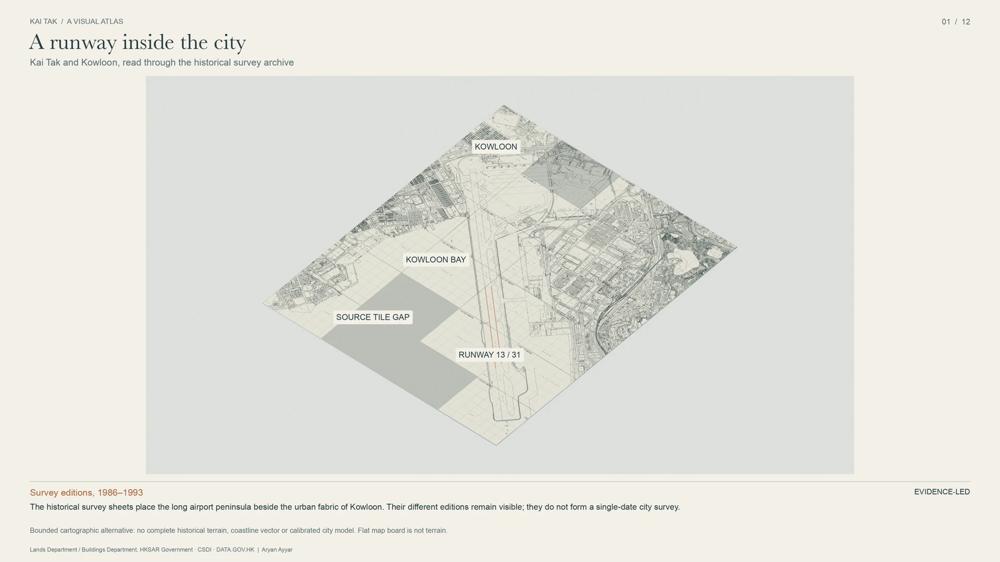

# Checkers with Runway 13

**A 47° turn over Kowloon. A runway that still had to be long enough to stop.**

Historical geography · 3D reconstruction · Flight dynamics · Mathematical verification

<!-- current-products:start -->
[**Read the Paper · v5**](research/checkers-runway13/whitepaper/v5/checkers-with-runway-13-white-paper-v5.pdf) · [**Explore the Historical Archive**](archive/README.md) · [**View the 3D Atlas**](visual-atlas/README.md)
<!-- current-products:end -->

*From the [Kai Tak Visual Atlas](visual-atlas/v1/README.md). Historical sources,
model geometry and illustrative context are identified separately in the atlas.*

## The question

Kai Tak's Runway 13 approach brought large aircraft over densely built Kowloon.
An offset instrument approach led into a visual right turn toward the runway.
The spectacle conceals a demanding engineering question:

> How can an aircraft turn, descend, align, touch down, and still have room to stop?

This independent research project investigates that question through dated maps
and photographs, flight and weather evidence, three-dimensional reconstruction,
explicit mathematical models and computer-assisted verification.

The models construct complete calm-air and steady-wind landings with continuous-time
feasibility certificates under stated assumptions. Historical reconstruction is a
separate, unfinished investigation: these results do not establish clearance over
1993 Kowloon or operational flight safety.

A later [conditional local-optimality result](publication/scientific-results-20261013/README.md)
extends the mathematical investigation under explicit assumptions. Its global and
historical limits remain visible in the [current research status](docs/PROJECT_STATUS.md).

## Choose a path

| Discover | Investigate | Reproduce |
|---|---|---|
| [Read the paper](papers/README.md) | [Browse nine archive collections](archive/CATALOGUE.md) | [Start with the reproduction guide](docs/REPRODUCIBILITY.md) |
| [Explore the visual atlas](visual-atlas/README.md) | [Follow the evidence and research map](docs/RESEARCH_MAP.md) | [Enter the scientific laboratory](research/README.md) |
| [Take the five-minute tour](docs/START_HERE.md) | [See what is established and unresolved](docs/PROJECT_STATUS.md) | [Understand the architecture](docs/ARCHITECTURE.md) |

The paper, data archive and atlas have independent version histories. Older
editions and their scientific evidence remain available at their original paths.

## Author and sources

Research by **Aryan Ayyar**, with AI-assisted implementation, drafting and checking.
Historical source institutions include the Lands Department and Buildings
Department of the Hong Kong SAR Government, CSDI, DATA.GOV.HK and NOAA/NCEI.

Source-specific rights apply; no blanket open-source licence is granted. The public
archive distributes a permitted subset of the wider research inventory.
[Attribution and use](NOTICE.md) · [Source and rights guide](docs/SOURCE_AND_RIGHTS.md) ·
[Citing a paper or dataset](papers/README.md#citation) · [Extend the project](docs/CONTRIBUTING.md)
