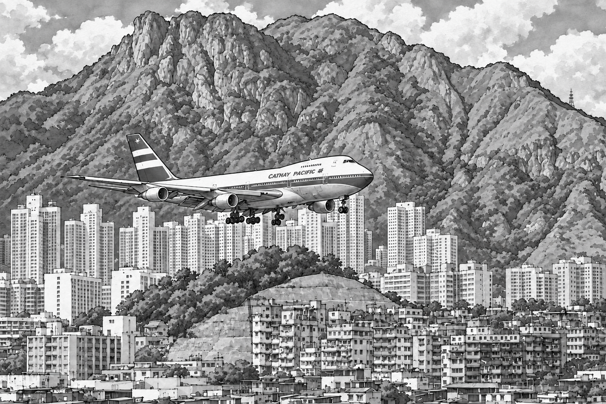
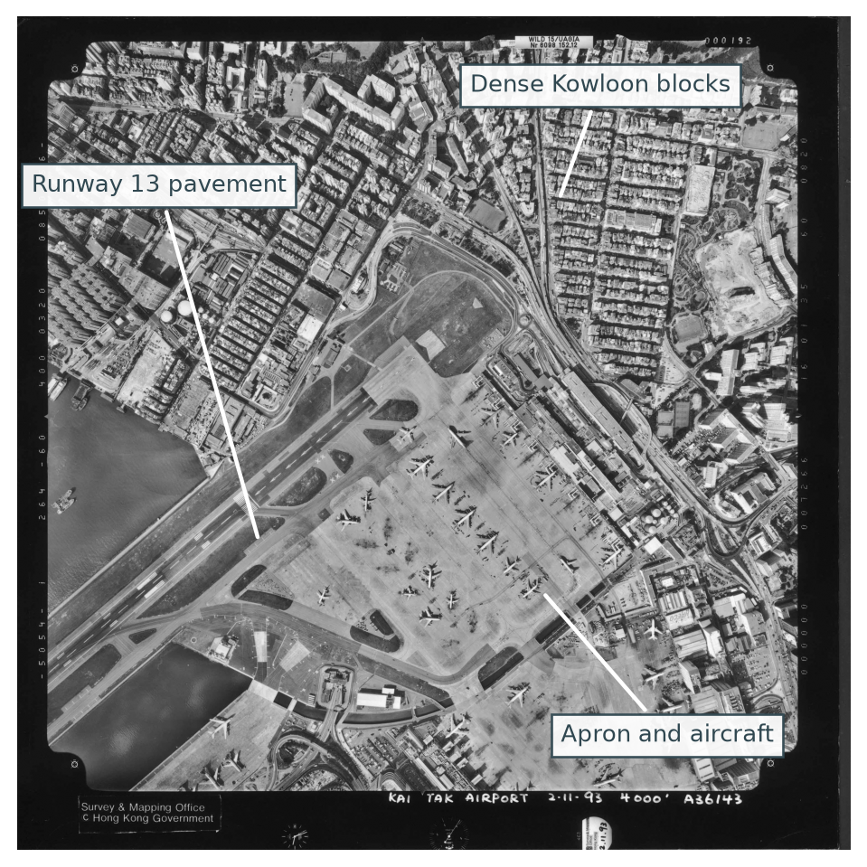
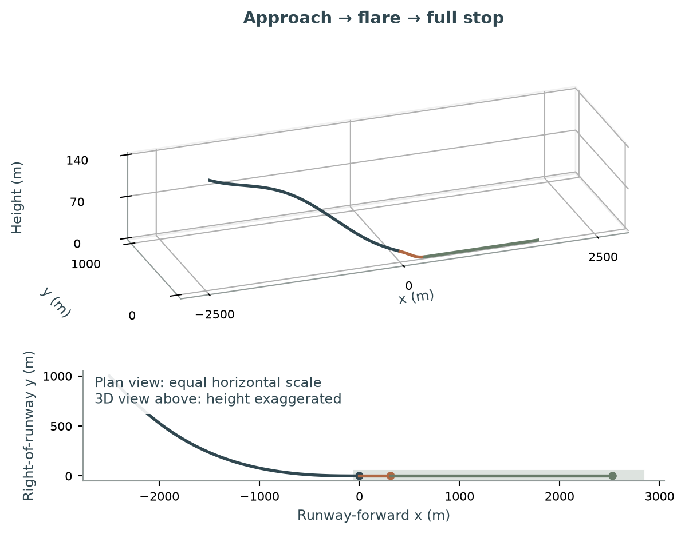

# Checkers with Runway 13

**A lost airport. A 47° turn over Kowloon. The mathematics of getting an aircraft all the way to a stop.**

*Cover artwork is an illustration, not a historical photograph or a reconstructed flight path.*

[**Read the white paper (v4, PDF)**](research/checkers-runway13/whitepaper/v4/checkers-with-runway-13-white-paper-v4.pdf) · [**Explore the research**](#explore-the-project) · [**Browse the data**](#historical-data-and-archive) · [**Reproduce the results**](#reproduce-the-research)

---

## An extraordinary approach, a deceptively simple question

Before it closed in 1998, Hong Kong's Kai Tak Airport was famous for an approach that brought large aircraft over densely built Kowloon. Runway 13 used an **offset Instrument Guidance System (IGS)** followed by a **visual right turn** toward the runway. The published instrument and runway directions differ by about **47°**. The final turn required visual references; it was **not** a zero-visibility landing procedure.

The view was spectacular. The engineering question is more interesting:

> **How could an aircraft turn, descend, align with Runway 13, touch down, and still have enough distance to stop?**

This independent project investigates that question through historical maps, dated aerial photographs, flight and weather evidence, three-dimensional surface reconstruction, explicit flight-dynamics models, and computer-assisted mathematical verification.

It also asks where the available evidence **stops**: a mathematically feasible path inside a simplified model is not a verified historical flight path or an aviation-safety finding.

## Start with the paper

### [Checkers with Runway 13 — Version 4 · RFS author format](research/checkers-runway13/whitepaper/v4/checkers-with-runway-13-white-paper-v4.pdf)

**35 pages · 16 reproducible scientific figures · 7 worked insights · 6 mathematical appendices**

The latest completed white paper is written for curious readers as well as technically trained researchers. It moves from the history and geography of Kai Tak to the mechanics of turning, descending, touchdown, braking, and the limits of what archival evidence can establish.

[Read the PDF](research/checkers-runway13/whitepaper/v4/checkers-with-runway-13-white-paper-v4.pdf) · [Read the abstract](research/checkers-runway13/whitepaper/v4/abstract.md) · [Download editable sources](research/checkers-runway13/whitepaper/v4/checkers-with-runway-13-white-paper-v4-sources.zip) · [Inspect claims and evidence](research/checkers-runway13/whitepaper/v4/CLAIMS_AND_EVIDENCE.csv) · [Verification report](research/checkers-runway13/whitepaper/v4/VERIFICATION.md)

*Historical source illustration from the white paper, based on a Lands Department open-data aerial frame. The catalogue and handwritten frame dates disagree; the discrepancy is documented rather than silently resolved. See the [figure rights and provenance](research/checkers-runway13/whitepaper/v4/RIGHTS_AND_PROVENANCE.md).*

Version 4 uses the RFS author format already used by Aryan’s website papers: Times 12-point text, journal-style proportions and author–year references. It preserves Version 3’s complete scientific content and figures; this is a format edition, not an RFS publication or a new scientific result. All 35 pages were visually inspected, and the editable package was rebuilt from a clean folder. The first-person foreword remains marked for author review.

The illustrated [33-page Version 3](research/checkers-runway13/whitepaper/v3/checkers-with-runway-13-white-paper-v3.pdf), its [sources and verification](research/checkers-runway13/whitepaper/v3/README.md), and the earlier [30-page Version 2](research/checkers-runway13/whitepaper/v2/checkers-with-runway-13-white-paper-v2.pdf) remain unchanged and available.

## Explore the project

| Follow your curiosity | Where to go |
| --- | --- |
| **What did the airport and Kowloon look like?** | [Historical survey sheets, photographs and building chronology](research/checkers-runway13/reconstruction/chronology/REPORT.md) |
| **Can photographs reveal the old city in 3D?** | [Photogrammetric reconstruction](research/checkers-runway13/reconstruction/block_matching/REPORT.md) and [3D workbench documentation](research/checkers-runway13/reconstruction/block_matching/scene/README.md) |
| **How does a complete mathematical landing work?** | [Flight model](research/checkers-runway13/README.md), [calm-air analytical results](research/checkers-runway13/analytical/coupled/RESULTS.md), and [wind-conditioned landing](research/checkers-runway13/counterfactual/REPORT.md) |
| **What can the historical accident record tell us?** | [CAL605 flight and weather evidence](research/checkers-runway13/evidence/cal605_reconstruction/SPEC.md) |
| **What would a historical aircraft-clearance calculation still need?** | [Historical integration report](research/checkers-runway13/integrated/REPORT.md) and [archival records follow-up](research/checkers-runway13/integrated/records_followup/REPORT.md) |
| **Which questions are resolved, disputed or still open?** | [Project research ledger](research/checkers-runway13/PROJECT_STATE.md) and [literature comparison](research/checkers-runway13/literature/LITERATURE_AND_COMPARISON.md) |

### A city recovered in layers

The project brings together several kinds of evidence, rather than treating one aerial image as a complete 3D city:

| Research material | Documented scope |
| --- | --- |
| Historical survey-sheet archives | **227** acquired editions covering **93** sheet locations |
| Historical full aerial photographs | **48** acquired frames |
| November 1993 stereo-derived surface | **171,307** dense points and a **partial, non-watertight** observed-surface mesh |
| Visually reviewed historical mapped faces | **45** faces across selected 1989, 1994 and 1997 editions |
| Later source-bound integrated evidence | **88** features, including point observations, mapped faces and other evidence types |

The reconstructed stereo surface includes roofs, ground, vegetation and possibly erroneous matches; it is **not** a complete model of every building. Most dense points fall outside the local map-control hull, and their heights use a fitted **relative reference plane**, not Hong Kong Principal Datum. Historical footprints with unknown heights remain unknown. The 2026 building dataset is a **separate modern comparison**, not a substitute for the 1993 skyline.

For the existing reconstruction, begin with the [3D workbench README](research/checkers-runway13/reconstruction/block_matching/scene/README.md). Its full viewer and large geometry depend on the restored data package; a publicly hosted interactive demo is not claimed here.

### From an approach to a complete stop

*Model illustration: the calm-air constructed landing. It does not demonstrate the clearance or flyability of a historical Boeing 747.*

The research supplies **two separate synthetic landing scenarios** under stated simplified dynamics and braking assumptions:

| Model scenario | Touchdown beyond threshold | Full stop from threshold | Runway remaining |
| --- | ---: | ---: | ---: |
| Calm-air reference | 313.49 m | 2,531.32 m | **254.68 m** |
| Steady wind, 070° true / 21 kt | 302.11 m | 2,233.23 m | **552.77 m** |

Both constructed paths have computer-assisted **continuous-time feasibility certificates within their specified mathematical models**. The wind and calm cases are separately optimized scenarios: their difference is **not** an identified causal effect of wind. Neither establishes historical obstacle clearance, near-global optimality, a validated aircraft performance envelope, or operational safety.

[Read the mathematical verification](research/checkers-runway13/whitepaper/v3/VERIFICATION.md) · [Explore seven explanatory insights](research/checkers-runway13/whitepaper/v3/INSIGHTS.md)

## Historical data and archive

Research code, reports, source catalogues and smaller results are in Git. Larger, permitted-to-distribute data and derived assets are supplied through existing GitHub release archives.

The [current release manifest](publication/release_assets.json) selects **five archive bundles**, containing **1,254 files** in approximately **1.70 GB compressed**. These are dated research snapshots, **not yet a separately licensed, semantically versioned public archive release**.

| Archive group | What it contains |
| --- | --- |
| Chronology | Historical map/photo evidence and documentary datasets |
| Geospatial | Terrain and contemporary building source data |
| Reconstruction | Surface, mapping and intermediate 3D research assets |
| Supporting data | Additional research data and outputs |
| Integrated data | Later historical-integration imagery and related evidence |

[Initial snapshot](https://github.com/ayyararyan/kai-tak/releases/tag/snapshot-2026-10-13) · [Reconstruction and supporting update](https://github.com/ayyararyan/kai-tak/releases/tag/update-2026-10-13) · [Historical integration update](https://github.com/ayyararyan/kai-tak/releases/tag/integration-2026-10-13)

**Download and restore the selected data archives:**

~~~bash
git clone https://github.com/ayyararyan/kai-tak.git
cd kai-tak
python3 scripts/fetch_data.py
~~~

The downloader checks SHA-256 hashes, verifies archive members and refuses to overwrite conflicting local files. It can also verify downloaded bundles without extraction using the documented options.

For exactly what is included, excluded, attributed or only linked externally, consult the [data provenance and publication scope](DATA_SOURCES.md), [publication manifest](publication/snapshot_manifest.json), and [asset manifest](publication/release_assets.json). **Acquiring a historical document does not automatically confer redistribution permission.**

## Reproduce the research

### Rebuild white paper v3

The portable manuscript includes its frozen numerical inputs, plots, source code and proof-checking scripts. It requires Python, Tectonic and Poppler; see the [full build guide](research/checkers-runway13/whitepaper/v3/README.md).

~~~bash
cd research/checkers-runway13/whitepaper/v3
python3 -m venv .venv
.venv/bin/python -m pip install -r requirements.txt
.venv/bin/python build.py
.venv/bin/python verify_certificates.py
~~~

The paper's verification record reports **89 passing model/counterfactual tests**, **104 checked frozen inputs**, and a source-only clean rebuild that matched all **33 pages in extracted text and rendered pixels**. These are recorded project checks, **not independent aerospace peer review**.

### Reproduce the wider model and reconstruction

The [core flight-model README](research/checkers-runway13/README.md) covers its dedicated numerical environment and tests. Geospatial processing has [different dependencies](research/checkers-runway13/geospatial/README.md). Some source-bound historical integrations require third-party originals that are intentionally **not redistributed**; their acquisition references and expected checks are recorded, rather than bypassed.

## What remains an open research question?

**The key distinction:** showing that a continuous trajectory satisfies a reduced model's constraints is not the same as showing that a specific historical aircraft could follow it safely over 1993 Kowloon.

The project is still working toward date-specific historical obstacle geometry, reliable runway-end and vertical-datum registration, aircraft/gear/attitude calibration, and defensible treatment of uncertainty and tracking. The later integration work identifies a material runway-reference mismatch and specific archival records worth acquiring; it **does not** claim to have resolved those issues or derived the historical closed-form optimal landing.

[Read the integration findings](research/checkers-runway13/integrated/REPORT.md) · [Review the exact archival leads](research/checkers-runway13/integrated/records_followup/REPORT.md)

This is an **independent research and historical-education project**, not flight guidance, an airworthiness assessment or a validated accident-prevention analysis.

## Author, attribution and use

**Aryan Ayyar** works in financial economics and mathematics. This project grew from a longstanding fascination with the engineering of Kai Tak, and from time spent studying and living in Hong Kong. Its purpose is to make a difficult and beautiful engineering question investigable through explicit models, source material and reproducible results.

The research used **AI-assisted implementation, drafting and checking**; the manuscript does not claim independent human specialist review.

Original research and code are copyright © 2026 Aryan Ayyar. **No blanket open-source license has yet been granted.** Third-party datasets, photographs, maps and publications retain their own rights and use conditions. Hong Kong Government open-data material is attributed to its source institutions under the applicable DATA.GOV.HK/CSDI terms. Restricted report scans and scholarly PDFs are inventoried or linked, not republished where permission has not been established.

[Rights and attribution](NOTICE.md) · [Source-by-source publication scope](DATA_SOURCES.md) · [White-paper figure provenance](research/checkers-runway13/whitepaper/v3/RIGHTS_AND_PROVENANCE.md)

For scholarly reference, cite **Ayyar, A. (2026), _Checkers with Runway 13_, white paper v3**, with the [versioned PDF](research/checkers-runway13/whitepaper/v3/checkers-with-runway-13-white-paper-v3.pdf) and the specific dataset release or source record used. A persistent archive DOI is not claimed.
