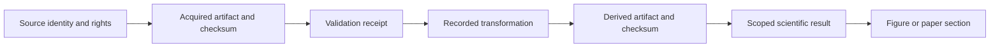

# Provenance and metadata contract

The catalogue separates **sources**, **datasets**, **artifacts**, **acquisitions**, **processing activities** and **publication uses**. JSON Schema version 1.0.0 describes required fields; `scripts/archive_validate.py` checks identity/reference integrity and inclusion policy.

- Sources: stable `src-*` product/document IDs; creator, landing URLs, dates and rights.
- Datasets: stable `kt-*` semantic IDs, collection membership, scientific interpretation and counts.
- Artifacts: `artifact-` plus the first 20 hex digits of SHA-256 of the original canonical relative path. Content hashes are separate. Changing content does not silently change identity or published version.
- Acquisitions: exact product/sheet/frame identifiers, acquisition times, source URLs, original sizes/hashes, edition/capture distinctions and verified ZIP member records.
- Processing: dataset-level producer/parent records; exact artifact edges only where evidenced. Attribution edges do not assert that every file used every source in its dataset.
- Publications: [dataset-to-section/figure records](catalogue/publication_usage.json), including explicit interpretation boundaries.

This is the **target chain**, not an assertion that every legacy file already has every edge. `provenance_status` distinguishes exact checksum-bound acquisitions, fresh producer replay, proposed authorship and dataset-level-only attribution. Missing lineage remains explicit. Null acquisition/publication/observation/revision dates are unknown; filesystem mtime is never substituted. Map edition months, photograph capture dates, 2026 dataset revisions and 1993 event dates are distinct.

[Artifact JSON](catalogue/artifacts.json) · [Source register](catalogue/sources.json) · [Accessions](catalogue/accessions.json) · [Activities and edges](catalogue/provenance.json) · [Dataset CSV](catalogue/datasets.csv) · [Schemas](schemas/)

Original/public-copy hashes can differ where the prior publisher normalized operational metadata; both are preserved. Existing frozen paper evidence is a versioned copy, not automatically the current derivative. Duplicate bytes are reported, never deleted. Private session/correspondence and runtime-file details remain only in the local audit, outside the public catalogue.
