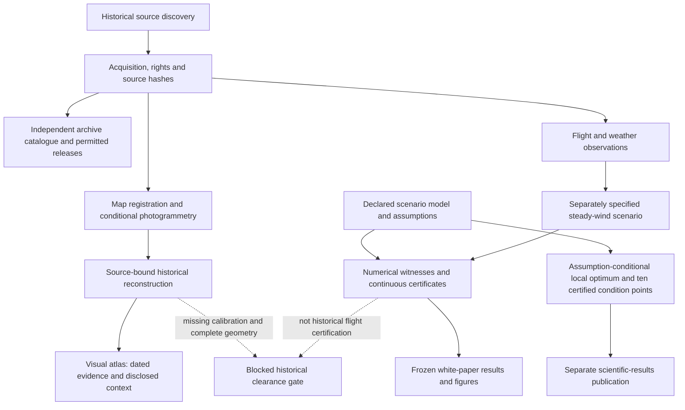

# From historical observation to research

[Project guide](README.md) · [Laboratory](../research/README.md)

The historical and mathematical branches meet at explicit evidence gates. A
finished visualization does not mean those gates have been passed.

## Traceable connections

Paths below are repository-relative. Bulk originals may require restoration;
restricted originals require independent acquisition under their own terms.

| Connection | Actual producer / binding evidence | Interpretation |
|---|---|---|
| Discovery → acquisition | [Dated acquisition inventory](../data/kai-tak-2026-10-13/README.md), [integration source inventory](../publication/integration_source_inventory.json), `reconstruction/chronology/aerial/fullframe_manifest.json` | An index listing is not an acquired full-resolution frame |
| Acquisition → archive | [Sources](../archive/catalogue/sources.json), [datasets](../archive/catalogue/datasets.json), [artifacts](../archive/catalogue/artifacts.json), [rights registry](../archive/licensing/rights_registry.json) | Stable identities and inclusion decisions; catalogue is larger than permitted bundles |
| Survey sheets → registered maps | `reconstruction/chronology/sheets/maps/` → `reconstruction/block_matching/register_sheets.py` → `registered/sheet_registration_inventory.json` | Registration is evidence with uncertainty, not an exact historical survey |
| A36142/A36143 → stereo surface | `chronology/aerial/fullframes/` → `block_matching/aerial_registration/build_sparse_stereo.py`; dense points, observed PLY/GLB and mesh reports | Conditional relative geometry; holes and control extrapolation remain |
| Maps/stereo → integrated geometry | [Source manifest](../research/checkers-runway13/integrated/source_manifest.json), `block_matching/HANDOFF.json`, historical faces and `obstacles/readiness.json` | Whole-aircraft clearance still requires calibrated geometry and registration |
| CAD/weather → observed evidence | `data/kai-tak-2026-10-13/sources/CAD_1-95_CAL605_wayback.pdf` → CAL605 reconstruction scripts; NOAA station-year gzip → `noaa/decode_noaa.py` | Manual recorder readings are not raw DFDR; station weather is not a gust field along the flight |
| Scenario primitives → numerical results | [Model specification](../research/checkers-runway13/MODEL_IMPLEMENTATION_SPEC.md), `model/config.json`, `model/trajectory.py`, [counterfactual specification](../research/checkers-runway13/counterfactual/SPEC.md) | Fixed synthetic start/corridor, declared aircraft and braking assumptions |
| Witness → mathematical certificate | `analytical/coupled/certify_candidate.py`, `continuous_certificate_refined.json`; `counterfactual/continuous.py`, `continuous_check.json` | Feasibility within each exact model; no matching historical or global-optimality conclusion |
| Scientific evidence → paper | [V4 frozen manifest](../research/checkers-runway13/whitepaper/v4/SOURCE_MANIFEST.json), [claim ledger](../research/checkers-runway13/whitepaper/v4/CLAIMS_AND_EVIDENCE.csv), figure/build scripts | Manuscript consumes a frozen snapshot, not the latest live tree |
| Declared assumption amendment → local theorem | [Assumptions](../research/checkers-runway13/integrated/assumption_solution/ASSUMPTIONS.md), [local certificate](../research/checkers-runway13/integrated/assumption_solution/refinement/local_certificate/certificate.json), [public mapping](../publication/scientific-results-20261013/source_public_mapping.json) | Local optimality within a declared finite family; no historical certification or global optimum |
| Frozen evidence → editorial edition | [V5 source manifest](../research/checkers-runway13/whitepaper/v5/SOURCE_MANIFEST.json), [claim ledger](../research/checkers-runway13/whitepaper/v5/CLAIMS_AND_EVIDENCE.csv), [publication receipt](../publication/v5_verification.json) | New narrative and figure system, preserved scientific models; not a retroactive incorporation of every newer laboratory result |
| Reconstruction → atlas | [25-input manifest](../visual-atlas/v1/metadata/input_manifest.json), [cameras](../visual-atlas/v1/metadata/cameras.json), preparation/render/composition scripts | Relative stereo, dated maps and modern comparison remain separate |

Unqualified reconstruction paths in this table are under
`research/checkers-runway13/reconstruction/`. CAL605 scripts are under
`research/checkers-runway13/evidence/cal605_reconstruction/`.

## The connection not yet established

`integrated/registration.json`, `integration_status.json` and
`geometry/airframe_envelope.json` feed `integrated/evaluate.py`.
The historical gate refuses clearance certification while required inputs are
unidentified or uncalibrated. Its exit code 2 is expected blocked-state behavior.
No arrow from historical reconstruction to an accepted historical optimum exists.

See [current status](PROJECT_STATUS.md) for remaining dependencies and the
[integration report](../research/checkers-runway13/integrated/REPORT.md) for their
scientific consequences.
