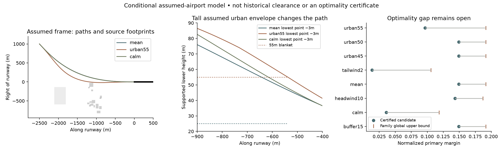

# Conditional landing solution: verified paths, explicit regimes and optimality gaps

## Result

Using the existing sources and explicitly authorized assumptions, this package constructs **eight complete approach–flare–touchdown–stop trajectories** with continuous conditional feasibility checks. It also derives exact stopping/terminal regimes and a stronger global exclusion bound for the retained polynomial family. This is material downstream progress, not a catalogue or a wait for further data.

**The full condition-dependent global closed-form optimum remains incomplete.** Numerical coefficient selection, even followed by interval feasibility verification, is not a closed-form optimizer. The best certified baseline margin and the global upper bound do not coincide. No global secondary-effort minimizer or complete parameter-domain active-regime map has been proved.

Authority: Aryan's “Wait, try your best without additional data and make assumptions where needed”, recorded in the sole [project ledger](../../PROJECT_STATE.md). See the additive [specification amendment](SPEC_AMENDMENT.md), [assumption register](ASSUMPTIONS.md) and [coverage audit](TRACEABILITY.md). No new evidence was acquired after that correction; no enquiries, publication, spending or agents were used.

## Baseline worked landing

In the assumed runway frame, use constant wind **(−4.876589553, 9.640066672, 0) m/s**, baseline aircraft/configuration and the specified assumed scene. Time starts at the synthetic entry, not at any recorded flight event.

| Event | Time from entry (s) | CG position (m) |
|---|---:|---|
| Entry | 0 | (−2500, 1000, 146) |
| Threshold / flare begins | 41.209032 | (0, 0, 21.24) |
| Ideal touchdown | 45.347804 | (301.996569, 0, 6) |
| Braking begins | 47.347804 | (447.031252, 0, 6) |
| Stop | 96.645877 | (2234.513819, 0, 6) |

Touchdown ground speed is **72.517341 m/s (140.962434 kt)**. The model stops with **551.486181 m of runway remaining**, exceeding the preserved 150 m reserve. The original two-second delay and 1.4709975 m/s² deceleration are unchanged. Vertical sink −0.7 m/s is reset to zero by an explicit ideal contact assumption, not a validated suspension simulation.

The selected path has numerical minimum margin 0.152305694; the continuous certificate establishes **η ≥ 0.149305694**. The 0.003 difference is a conservative certification allowance, not a measured physical uncertainty. The local secondary search reduces effort from about 7.2514 to 6.8204 while retaining the local primary margin within 10⁻⁴. Its comparison is to the numerical local primary benchmark, not to an unknown global optimum.

[Baseline formula and all coefficients](cases/mean/formula.json) · [trajectory and controls](cases/mean/path_controls.csv) · [continuous certificate](cases/mean/continuous.json) · [independent replay and bounds](cases/mean/verification.json)

## Conditions and sensitivity

All eight rows below have continuously checked flight and rollout, independent forward replay, and a successful local secondary-retention check. Margins are dimensionless normalized operating margins, **not probabilities or percentages of safety**. Upper bounds apply to the stipulated 12-parameter polynomial family, not arbitrary aircraft paths.

| Condition | Certified margin lower bound | Family optimum upper bound | Touchdown (m) | Stop (m) | Runway left (m) |
|---|---:|---:|---:|---:|---:|
| buffer15 | 0.149306 | 0.191605 | 302.00 | 2234.51 | 551.49 |
| calm | 0.036071 | 0.118560 | 313.61 | 2533.01 | 252.99 |
| headwind10 | 0.143251 | 0.186915 | 300.95 | 2250.48 | 535.52 |
| mean | 0.149306 | 0.191605 | 302.00 | 2234.51 | 551.49 |
| tailwind2 | 0.013805 | 0.105573 | 317.64 | 2591.67 | 194.33 |
| urban45 | 0.149306 | 0.191605 | 302.00 | 2234.51 | 551.49 |
| urban50 | 0.149296 | 0.191605 | 301.98 | 2234.54 | 551.46 |
| urban55 | 0.096485 | 0.191605 | 413.40 | 2373.75 | 412.25 |

`mean` has an assumed 25 m urban blanket above runway; `urban45/50/55` change that blanket to 45/50/55 m. These labels do not mean that observed building heights were recovered. `buffer15` increases the horizontal buffer from 5 to 15 m; `headwind10` and `tailwind2` are pure along-runway winds in knots. Each condition gets a separately optimized path; this is not a single gust-responsive feedback law.

Three further cases, `tailwind5`, `urban60` and `urban65`, produced **no accepted positive-margin path**. They remain unresolved, not proved infeasible. The joint frame/datum case (+80 m along, −50 m lateral, runway level 4 m HKPD) is excluded within the imposed conservative geometry model: its fixed gate violates a hard predicate by 10 m for every admissible path. That predicate is only a sufficient physical-separation test; its failure does not prove real-world collision.

The higher 55 m blanket materially changes the construction: touchdown moves from about 302 to 413 m, effort rises to 17.1032, and certified margin falls to 0.096485. The individual source-derived obstacle boxes are not the active geometry limiter in these examples; the **assumed background urban blanket** supplies the relevant limitation. The 45 source polygon forms include multiple map editions, not 45 independently identified historical buildings.



[Full machine-readable conditions](conditions.json) · [CSV table](conditions.csv) · [PDF figure](conditional_landings.pdf)

## What is exact, numerical and still unproved

The [inspectable derivation](DERIVATION.md) separates eight parts: polynomial construction, force/control inversion and body geometry; hybrid contact/stop; terminal optimization; geometry switches; finite-family existence and local active-set equations; continuous verification; and the stronger flare-energy upper bound.

**Exact under the assumptions:** given the selected parameters, the path is an explicit Hermite-plus-bump polynomial, with analytic velocities, accelerations and force/rate inversion. After touchdown, with u=t−tD, U the ground speed, τ=2 and a=1.4709975:

- Delay, 0≤u≤τ: x=xD+Uu.
- Braking, τ≤u≤τ+U/a: x=xD+Uτ+U(u−τ)−a(u−τ)²/2.
- Stopped: x=xD+Uτ+U²/(2a).

The reserve condition has the explicit speed ceiling U≤−aτ+√[a²τ²+2a(2636(1−η)−xD)], on its stated nonnegative domain. These are sufficient and necessary stopping regimes for the stipulated ground law, not for the whole airborne problem.

**Exact relaxed optimality:** a monotone touchdown-speed/stopping relaxation reduces to a unique scalar root (or endpoint regime), with an algebraic quartic representation and explicit unsquared sign selection. The inherited U≥69 m/s family floor adds an exact constant-speed regime with η=66656817/307536544. These solve relaxed terminal problems; their sufficiency cannot be transferred to the full trajectory problem.

**New globally valid exclusion within the family:** a flare energy inequality combines bounded drag/work, height and vertical speed with exact stopping. The scalar relaxed minimum is attained among endpoints, a speed-floor switch and an explicit stationary point. Outward interval checks over 2048 touchdown-position cells certify the reported exclusions. For baseline conditions this tightens the family upper bound to **0.191605**, giving

**0.149305694 ≤ η*family ≤ 0.191605.**

The unresolved certified gap is 0.042299306. The terminal-only full-class upper bound is approximately 0.223501289; the stronger energy bound must not be assigned to that broader class. The finite-family existence proof establishes attainment on a nonempty compact feasible set, not identification or uniqueness of the maximizing path.

**Numerical/local only:** parameter selection and secondary minimization. Local active-time/KKT systems and implicit-function sensitivity equations are written down, but have not been solved into a global condition partition or a sufficient global optimizer certificate. There is no proof that an unrestricted optimum belongs to this polynomial family. No claim that such a closed form is impossible is made.

Remaining target work is mathematical: close the candidate/upper-bound gap or obtain a global optimizer certificate; derive the condition-domain active-regime map; prove global secondary optimality; resolve the three unsuccessful conditions. The current result does not treat missing external data as the blocker.

## Assumptions and interpretation

The conditional scene adopts an unvalidated runway frame and 6 m HKPD runway level, assigns tops to source footprints and light points, adds an assumed hill cap and background urban blanket, and preserves all original unknown fields. Aircraft CG height, body box, gear reference, pitch/track/bank closure and ideal impact are explicit model assumptions. The original baseline force limits, primary margin objective and secondary effort objective remain in place.

Whole-body separation uses a 55 m horizontal circumscribed radius plus buffer and bank-dependent lower support. This is conservative within the assumed body model, not calibrated historical aircraft clearance. The density is evaluated at actual assumed CG altitude; the virtual trajectory reference is six metres vertically below CG, not a rotating material gear point. The contact/rollout model assumes adequate tyre authority and successful landing/brake mode. It does not establish impact loads, real six-degree-of-freedom control feasibility or operational flight guidance.

Historical certification remains **false**. Deterministic sensitivity scenarios are not physical prediction intervals. A causal gust policy and go-around viability solution are absent. These limitations cannot be cured by relabelling an optimizer convergence flag.

## Verification and repairs

[Verification receipt](verification.json): **64 tests pass**, **397 prior artifacts and 13 frozen inputs unchanged**, eight accepted landings, one conditional fixed-gate exclusion and three unresolved conditions. New continuous certificates cover **2094 closed time cells** across the accepted flight phases and check complete rollout intervals. Certificate/result/source bindings and complete time coverage were checked.

Independent Newton-equation replay agrees with the explicit curves to at most 1.06×10⁻¹¹ m in position and 3.03×10⁻¹² m/s in velocity. These are numerical implementation checks, not physical accuracy claims. All eight local secondary searches satisfy their stated numerical retention check; no global secondary proof is claimed.

A material sampling defect was found in the early `urban55` candidate: it missed a small clearance violation immediately before leaving the urban half-plane. The original candidate and failure are preserved in [the pre-repair directory](cases/urban55/pre_exit_limit_repair/). The search now imposes the exact boundary-crossing root and one-sided vertical limit; the repaired path has a new continuous certificate. The full condition package, source bindings, contact and rollout checks were re-audited after the repair. Calm and urban55 secondary searches subsequently converged after numerical finite-difference refinement, without relaxing constraints or the retention budget.

Specification coverage: **five implemented, two partially implemented** amendment requirements. Conditional path evaluation is executable and verified; the full analytical/global target is **INCOMPLETE**. Historical artifacts and their earlier invalidations have not been rewritten.

## Use the deliverable

From the canonical research root:

```sh
.venv/bin/python integrated/assumption_solution/evaluate.py mean 20
.venv/bin/python integrated/assumption_solution/evaluate.py urban55 30
```

The evaluator reads the certified named case, verifies bindings and returns its trajectory/control state. `--side left` or `--side right` exposes phase-join limits and the touchdown reset. It rejects unsupported conditions and times outside entry-to-stop; it does not certify interpolation. [README](README.md) gives reproduction order; [artifact manifest](artifact_manifest.json) records delivered bytes.
